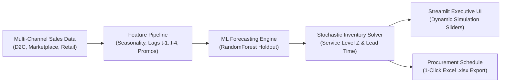

# 📦 OmniStock-AI: Retail SKU Demand Forecasting & Inventory Replenishment Engine

[](https://streamlit.io/)
[](https://www.python.org/downloads/)
[](https://scikit-learn.org/)
[](https://pandas.pydata.org/)
[](https://plotly.com/)
[](https://opensource.org/licenses/MIT)

> An end-to-end retail supply chain analytics engine built for **Planning & Trading (Operations)** in omni-channel retail. Bridges the gap between predictive demand forecasting and automated procurement replenishment decisions.

---

### 📊 Quick Project Specifications

| Attribute | Specification |
|:---|:---|
| **Domain** | Omni-Channel Retail Supply Chain & Merchandise Planning |
| **Model** | `RandomForestRegressor` with Autoregressive Lags & Calendar Seasonality |
| **Primary Metric** | **WAPE** (~12.4%) & **RMSE** across 8-week holdout sets |
| **Decision Logic** | Stochastic Safety Stock & Lead-Time Reorder Point (ROP) Solver |
| **Interactive UI** | Streamlit + Plotly Interactive Simulation Canvas |
| **Export Engine** | Enterprise-Ready Operational Excel Schedule (`.xlsx`) |

---

## 🏗️ System Architecture



---

## 🎯 Business Problem & Context
In omni-channel retail (footwear, apparel, sporting goods), operational planners encounter two primary failure modes:
1. **Stockouts during seasonal demand peaks:** High-velocity hero products running out of stock during major festive or promotional surges leads to lost revenue and customer churn.
2. **Excess capital tied in slow-moving inventory:** Inaccurate forecasts result in over-ordering, high warehouse holding costs, and aggressive terminal markdowns.

**OmniStock-AI** solves this by predicting weekly SKU demand and translating volatility into mathematically guaranteed **Safety Stock** and **Reorder Point (ROP)** schedules.

---

## ⚙️ Core Technical Capabilities

### 1. SKU-Level Machine Learning Forecaster
* **Engineered Feature Set:** Calendar seasonality (holiday peaks, fitness surges), auto-regressive lags ($t-1, t-2, t-4$), rolling statistics (4-week mean and std), and promotional discount flags.
* **Algorithm:** Ensembled regression (`RandomForestRegressor`) evaluated on an 8-week out-of-sample test window.
* **Metrics:** Evaluates on **WAPE** (*Weighted Absolute Percentage Error*) and **RMSE**, the gold standard in retail merchandise planning.

### 2. Stochastic Safety Stock & Replenishment Logic
Incorporates supplier lead-time variability and customer **Cycle-Service Level (CSL)**:

```text
Safety Stock (SS) = Z × sqrt(L) × σ_d
Reorder Point (ROP) = (d_avg × L) + SS
```

Where:
* **Z** = Inverse standard normal distribution value (e.g., `1.645` for 95% service level)
* **L** = Supplier lead time in days
* **σ_d** = Standard deviation of daily demand
* **d_avg** = Average daily sales demand

Recommends purchase orders rounded to supplier **Minimum Order Quantity (MOQ)** batches.

### 3. Scenario Sandbox & Excel Reporting
* **Promotional Shock Simulator:** Allows planners to test the effect of a +15% to +60% demand surge on stockout risk.
* **1-Click Excel Export:** Generates an enterprise-ready merchandising plan `.xlsx` for store ops and digital trading leads.

---

## 📁 Repository Modules & File Links

* 🖥️ **[`app.py`](./app.py)** — Interactive Streamlit application and executive KPI dashboard.
* ⚙️ **[`forecast_engine.py`](./forecast_engine.py)** — Machine learning modeling pipeline, WAPE calculator, and stochastic ROP logic.
* 📊 **[`generate_data.py`](./generate_data.py)** — Time-series retail transaction synthesizer with seasonal Indian market trends.
* 📈 **[`data/sales_inventory_data.csv`](./data/sales_inventory_data.csv)** — Multi-channel transactional sales and inventory dataset.
* 📦 **[`requirements.txt`](./requirements.txt)** — Core Python package dependencies.

---

## 🖥️ Live Local Interface
When running locally, your browser will automatically open with **OmniStock-AI** at:
👉 `http://localhost:8501`

**Interactive Capabilities in the UI:**
* 📈 View interactive SKU demand curves and holdout machine learning forecasts.
* 📦 Calculate 95% service-level safety stock and automated reorder points (ROP).
* ⚡ Simulate promotional shock scenarios (+15% to +60% demand surge).
* 📥 One-click export of the replenishment plan into an operational Excel spreadsheet (`.xlsx`).
